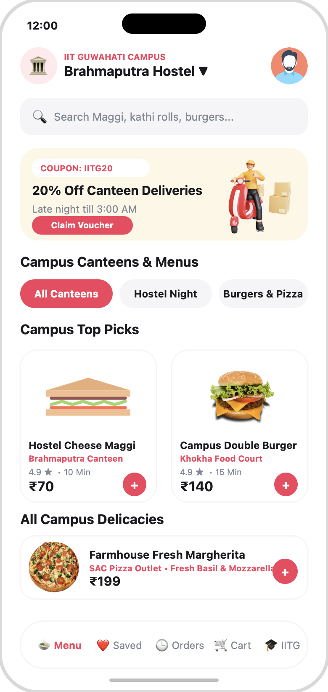
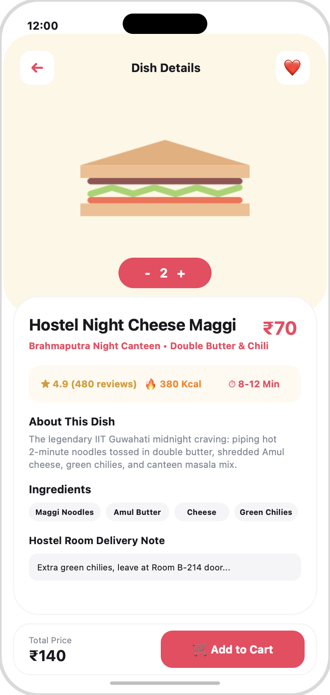
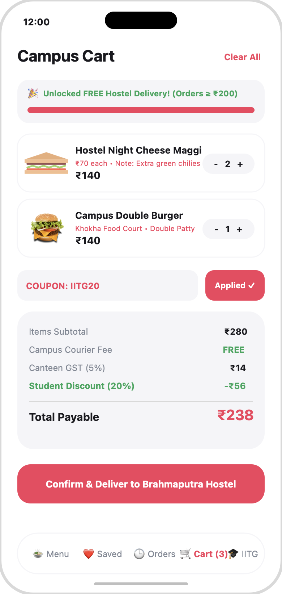
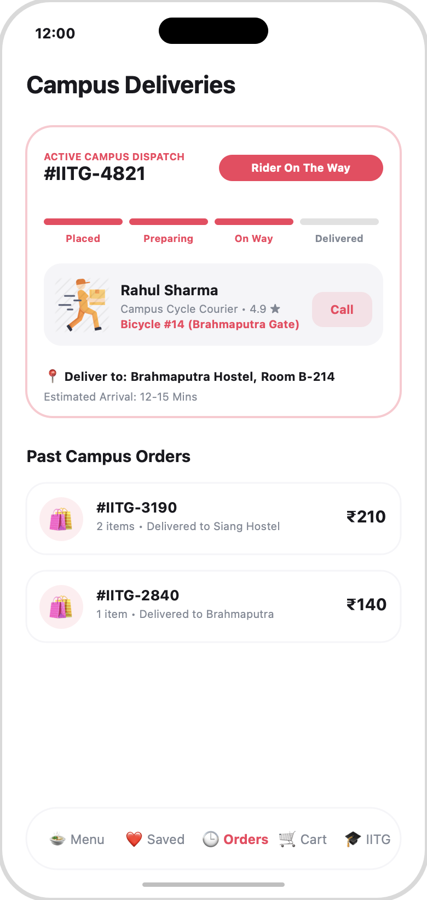

# 🎓 CampusBite — Hyperlocal Food Delivery for IIT Guwahati

[](https://developer.apple.com/ios/)
[](https://swift.org)
[](https://developer.apple.com/xcode/swiftui/)
[](https://developer.apple.com/documentation/observation)
[](https://developer.apple.com/documentation/xctest)
[](https://www.iitg.ac.in)
[](LICENSE)

**CampusBite** is a modern, student-centric iOS food delivery application engineered specifically for **8,000+ students, researchers, and faculty across the Indian Institute of Technology Guwahati (IITG)** campus. 

Built with **Swift 6**, **SwiftUI**, and Apple's modern **Observation Framework (`@Observable`)**, CampusBite bridges on-campus canteens (*Khokha Market, Brahmaputra Night Canteen, SAC Food Outlets, Core 1*) with late-night hostel deliveries.

Developed by **[Siddharth Patel](https://github.com/siddharth1407)** (B.Tech, IIT Guwahati) as an iOS Software Engineering portfolio project.

---

## 📱 App Flow & Preview Screenshots

| 1. Explore Menu & Hostels | 2. Food Details & Notes | 3. Cart & Student Promos | 4. Campus Bicycle Courier |
|:---:|:---:|:---:|:---:|
|  |  |  |  |
| **Brahmaputra Hostel Dropdown**<br>Campus categories & dishes | **Hostel Night Cheese Maggi**<br>Ingredients & room notes | **Coupon: IITG20**<br>Free hostel delivery threshold | **Rider: Rahul Sharma**<br>Live step-by-step dispatch |

> 💡 **Modern iOS Architecture**: Built with Swift 6 strict concurrency and Apple's modern Observation framework (`@Observable`), featuring real-time hostel routing and campus cycle courier dispatch.

---

## 🌟 Why CampusBite? (The Campus Problem)

At IIT Guwahati, student hostels (Brahmaputra, Siang, Kameng, Lohit, Umiam, etc.) are spread across a massive 700-acre campus. During exam midsems, coding hackathons, and late-night study sessions, commercial food apps cannot deliver inside hostel gates after midnight. 

**CampusBite** solves this through:
1. **Hostel Dropdown Selector**: One-tap delivery switching between all IITG hostels and academic complexes.
2. **Midnight Canteen Integration**: Real menus from Khokha Market stalls, Night Canteens, and SAC outlets.
3. **Student-Friendly Pricing (₹)**: Transparent rupee pricing with automated free delivery thresholds ($\ge ₹200$) and campus student coupons (`IITG20`, `MIDSEM`).
4. **Campus Cycle Courier Tracking**: Real-time status tracker designed for student bicycle couriers navigating campus pathways.

---

## 🚀 Key Features

### 🍲 1. IIT Guwahati Canteen Menus & Live Search
* **Authentic Campus Specialties**: Legendary Hostel Double Butter Cheese Maggi, Paneer Kathi Rolls, Campus Double Burgers, Farmhouse Pizzas, and Choco Truffle desserts.
* **Instant Filtering & Search**: Filter by *All Canteens*, *Hostel Night*, *Burgers & Fast Food*, *Pizza Hub*, and *Bakery & Desserts*.
* **Hostel Delivery Picker**: Seamlessly select between Brahmaputra, Siang, Kameng, Lohit, Umiam, Core 1, New SAC, and Khokha.

### 🛒 2. Full-Featured Cart & Financial Engine
* **Quantity Controls & Room Notes**: Add items, adjust servings, and leave custom delivery instructions (*"Extra spicy, leave at Room B-214 door"*).
* **Campus Financial Logic**: 
  * Standard ₹20 hostel courier fee.
  * **Free Delivery Threshold**: Orders $\ge ₹200$ automatically waive delivery fees.
  * **Campus Promo Coupons**: Try **`IITG20`** (20% student off), **`MIDSEM`** (25% exam fuel), or **`SIDDHARTH`** (30% VIP discount).
  * 5% Restaurant GST calculation.

### 🚲 3. Campus Courier Dispatch Lifecycle
* **Visual Status Pipeline**: **Order Placed** $\rightarrow$ **Canteen Preparing** $\rightarrow$ **Campus Rider On The Way** $\rightarrow$ **Delivered to Hostel**.
* **Student Courier Details**: Shows assigned campus partner (e.g. *Rahul Sharma • Bicycle #14, Brahmaputra Gate*).
* **Live Step Simulation**: Tap *"Next Step"* to demo each delivery phase during interviews and reviews.

### 👤 4. IITG Student Profile & Showcase
* Displays student profile (*Siddharth Patel, B.Tech IIT Guwahati, Brahmaputra Hostel*).
* Campus loyalty rewards points and direct GitHub source code links.

---

## 🏗️ Technical Architecture & Engineering Highlights

```
DeliveryApp/
├── DeliveryApp.swift             # App entry point (WindowGroup)
├── Info.plist                    # Bundle metadata (CFBundleDisplayName = "CampusBite")
├── models/
│   └── CategoryModel.swift       # Strong models (CampusLocation, Food, CartItem, Order, UserProfile)
├── controller/
│   └── FoodOrderController.swift # Observable MVVM ViewModel handling state & campus dispatch logic
├── View/
│   ├── HomePageView.swift        # Multi-tab view (Campus Menu, Saved, Deliveries, Cart, Profile)
│   └── FoodDetailsPage.swift     # Hero detail view with stepper, nutrition, and checkout bar
├── Assets.xcassets/              # Asset catalog (1x/2x/3x food imagery, color sets)
├── screenshots/                  # High-res preview mockup screenshots
└── DeliveryAppTests/
    └── DeliveryAppTests.swift    # Automated unit tests covering catalog, cart, promos, & hostel routing
```

### 🔹 Modern Observation Framework (`@Observable`)
* Replaced legacy `ObservableObject` and `@Published` wrappers with the iOS 17 `@Observable` macro.
* Granular property tracking guarantees that subviews reading only `selectedLocation` or `cartTotal` don't trigger unnecessary re-renders when other state changes.

### 🔹 Swift 6 Strict Concurrency & Clean MVVM
* Data-race safe domain models adhering to `Sendable`, `Identifiable`, and `Hashable`.
* Complete separation of business calculations from SwiftUI view declarations.

### 🔹 10 Automated Unit Tests (`XCTest`)
* Automated test suite verifying hostel selection, search indexing, item deduplication, ₹200 free delivery boundaries, student coupon validation (`IITG20`, `MIDSEM`, `SIDDHARTH`), and order lifecycle progressions.

---

## 🧪 Running Unit Tests in Xcode

1. Open `DeliveryApp.xcodeproj` in Xcode.
2. Select target scheme **DeliveryApp** with an iOS Simulator (e.g. iPhone 15 Pro / 16).
3. Press **`⌘ + U`** to run all tests.

---

## 💻 How to Run the App

### 1. Running in Xcode Simulator
1. **Install Xcode**: Download and install **Xcode** from the Mac App Store.
2. **Open the Project**:
   ```bash
   open DeliveryApp.xcodeproj
   ```
3. **Select Simulator**: At the top toolbar of Xcode, select any simulator device (e.g., **iPhone 15 Pro** or **iPhone 16**).
4. **Build & Run**: Press **`⌘ + R`** (or click the **Play** button in Xcode). The iOS Simulator will boot and launch **CampusBite**!

### 2. Running on a Physical iPhone
1. Connect your iPhone to your Mac with a USB-C / Lightning cable.
2. In Xcode, select your iPhone from the device destination menu.
3. In Project Settings under *Signing & Capabilities*, select your Apple ID under **Team**.
4. Press **`⌘ + R`** to run CampusBite directly on your phone!

---

## 👨‍💻 About the Developer

**Siddharth Patel**  
*B.Tech Student & Aspiring iOS Software Engineer*  
*Indian Institute of Technology Guwahati (IITG)*  
* **Email**: [siddharthkota01@gmail.com](mailto:siddharthkota01@gmail.com)  
* **GitHub**: [@siddharth1407](https://github.com/siddharth1407)

---

## 📄 License
This project is open-source and available under the [MIT License](LICENSE).
